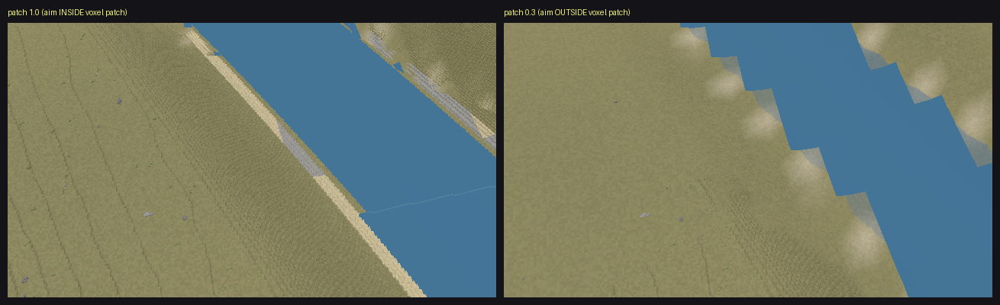
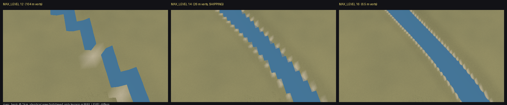
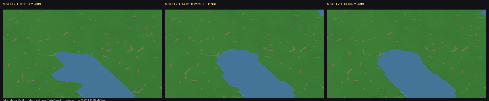
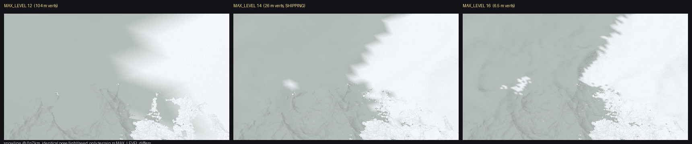

# X-1 — B-19 diagnosis: the 0.5–1 km staircase band

**Diagnosis only. Nothing was fixed.** `viewer/src/` is byte-identical to
`74cb703` at the end of this mission (`git status` clean); the MAX_LEVEL
experiments below were built, measured, and reverted.

---

## 1. The root cause, in one paragraph

Every irregular boundary the LOD mesh draws is carried to the GPU as a
**per-vertex scalar** — `Vertex::color` (the biome/snow categorical pick),
`Vertex::water.a` + `Vertex::wflag` (river wetness), `Vertex::shore` (the
signed sea/lake/pond water-minus-ground margin). The fragment shader can
interpolate and threshold those, which makes the edge *crisp*, but it cannot
invent shape between them. **No mesh-drawn boundary can have detail finer
than the mesh vertex spacing.** That spacing is
`(π/2 · R) / (2^level · TILE_QUADS)`, and `terrain.rs:22 MAX_LEVEL = 14`
caps it at **25.95 m** no matter how close the camera gets. The voxel
near-field, which evaluates the *same* fields per 1.35 m column, covers only a
disc of radius `(200 + (2.5 − alt_km)·120) · patch_scale` metres
(`renderer.rs:1820`) — a disc that **shrinks** as you climb. Between roughly
0.5 and 1 km the boundary you are looking at leaves that disc, and its
description changes from a 1.35 m lattice to a 25.95 m lattice in one step.
The per-pixel categorical reconstruction that *does* draw natural curves
(TRANSITIONS.md Round 4, B-17's `c9cb081`) is **switched off** in exactly this
range: `shader.wgsl:173 BIOME_RANGE_BLEND_START_KM = 4.0` (fragment distance)
and `shader.wgsl:226 COAST_RANGE_CURVE_START_ALT_KM = 12.0` (camera altitude).

**So there is an unserved annulus: ~0.5 km to ~4 km from the camera has
neither voxel truth nor per-pixel reconstruction.** B-19 is that annulus,
seen from the altitude where it fills the screen.

The measured 15–35 m pitch is 25.95 m, spread by how the world-aligned lattice
projects into screen space at each site's yaw. On the cleanest specimen
(`river_bank` @ 1 km) the boundary's modal lateral jump is **12 px × 2.16 m/px
= 25.9 m**, independently on both banks, against a predicted 25.95 m.

## 2. The code path

| step | where | what it does |
|---|---|---|
| LOD level choice | `terrain.rs:170-208 select_tiles` | splits while `size/dist > ERR_TARGET` (`renderer.rs:44` = 0.35), stops at `MAX_LEVEL`. `dist` is camera → tile centre **at sea-level radius**. |
| the cap | `terrain.rs:22` | `MAX_LEVEL = 14` → tile 0.830 km → **25.95 m** vertex spacing. Binds for every fragment closer than 2.37 km. |
| biome / snow boundary | `planet.rs:3201 climate_boundary_selection` → `choose_dithered_koppen` | a **hard categorical pick per evaluation point** against `boundary_zone_signal` (`planet.rs:544`), a 10-octave field whose wavelengths are 84.7 km … **0.83 m**. Called once per vertex from `terrain.rs:1908 shade_ground_pair`. |
| river bank | `terrain.rs:1874` | `wet` is per-vertex; on `deep` tiles it is **binary** (0/1) and the shader does `step(0.55, in.water.a)` (`shader.wgsl:1256`) → the edge is the 0.55 contour of a linear interpolant of a binary lattice. |
| lake / sea / pond shore | `terrain.rs:1527 shore_field` | one per-vertex signed scalar clamped to ±5 m; the shader steps its zero crossing per pixel with derivative AA (`shader.wgsl:1264-1281`). Crisp, but the contour is still piecewise-linear on 26 m triangles — hence straight edges and 45° notches. |
| the curve restoration, and its gate | `shader.wgsl:1291-1414` | `biome_range = smoothstep(4 km, 8 km, dist)`; the whole 5-octave per-pixel categorical reconstruction sits inside `if (biome_range > 0.0)`. Below 4 km `ground = in.color`, i.e. the raw interpolated vertex colour. |
| the coast curve restoration, and its gate | `shader.wgsl:837-887` | `coast_range_curved_shore` returns `shore` unchanged unless camera altitude > 12 km. |

The comment on the range gate says why it is there: *"ground frames paid ~6x
for zero pixels (2026-07-12 fps collapse)"*. It was a performance decision,
and the side effect is that the near field has no per-pixel boundary owner.

## 3. Evidence

Baseline first: `python scripts/altitude_ladder.py --only lake_shore,river_bank,snowline,ecotone --rungs 0.3,0.5,0.7,1,1.5,2,3 --tag=-x1base`
reproduces V-2's numbers to three decimals in this worktree
(`X1-evidence/report-x1base.json`; river_bank 3.413 / 10.326 / 14.995 / 21.511,
ecotone 35.428 …). The instrument is stable; the finding is real.

### 3.1 Who owns the pixels — `TRI_LOD_RING_DEBUG`, inverted per pixel

`scripts/x1_lod_owner.py` inverts the debug palette
(`renderer.rs:3439`, `band = level+1` for tiles, `0.5` for chunks) so every
pixel reports the renderer and LOD level that drew it. **0.0 % of pixels were
unmatched**, so this is a measurement, not an estimate
(`X1-evidence/x1-lod.json`, image `X1-evidence/x1-lod-ownership.png`):

| site | 0.3 km AGL | 0.7 km | 1.0 km |
|---|---|---|---|
| lake_shore | centre **chunk**, 68 % chunk | centre **L14**, 20 % chunk | centre **L14**, 9 % chunk |
| river_bank | centre **chunk**, 70 % chunk | centre **L14**, 20 % chunk | centre **L14**, 9 % chunk |
| snowline | centre L14, 60 % chunk | centre **L14**, 15 % chunk | centre **L14**, 7 % chunk |
| ecotone | centre **chunk**, 49 % chunk | centre **L14**, 14 % chunk | centre **L14**, 7 % chunk |

There is no level 15 or 16 anywhere — `MAX_LEVEL` is saturated everywhere in
the near field. The band is the voxel disc collapsing out of frame.

### 3.2 Same altitude, different owner — the `--patch` A/B

`--patch S` scales the voxel disc without moving the camera, the light, the
terrain or the boundary field. At **300 m AGL**, patch 1.0 puts the aim point
inside the disc (464 m vs 210 m) and patch 0.3 puts it outside (139 m vs
210 m):

Same river, same 300 m altitude, same second of game time. Left: naturally
meandering. Right: a rectangular staircase with ~26 m treads. Frame-wide
`step_m` moves in the predicted direction at **8 of 8** site×altitude pairs
(`X1-evidence/x1-patch.json`); the frame-wide number understates it because at
300 m the frame still contains both renderers.

`voxels on|off` at the identical poses (`X1-evidence/x1-voxab.json`) gives the
complementary control: at **river_bank @ 1 km, turning the entire voxel
near-field off changes the measured pitch by exactly zero** (21.511 → 21.511).
At 1 km the boundary is already 100 % mesh; the voxels contribute nothing.

### 3.3 The controlled intervention — `MAX_LEVEL`

One constant in `terrain.rs`, three builds, identical poses/light/seed,
`TRI_NO_IMPOSTORS=1` on all three arms so tree density cannot confound
(a control run at 14 with impostors is `report-x1base.json`, identical).

`river_bank` @ 1 km AGL, boundary lateral jumps in rows 60–400 (ground range
0.6–1.9 km, entirely mesh), 2.16 m/px (`X1-evidence/x1-pitch.json`):

| build | level actually selected (measured) | vertex spacing | predicted jump | measured jumps |
|---|---|---|---|---|
| `MAX_LEVEL=12` | 12 | 103.79 m | 48.1 px | 36, 40, 42, 46 px (plus sub-cell noise) |
| `MAX_LEVEL=14` (ship) | 14 | 25.95 m | 12.0 px | **12 px modal, on both banks independently** |
| `MAX_LEVEL=16` | **15** | 12.97 m | 6.0 px | 3–5 px — no staircase left |

The `MAX_LEVEL=16` row is the sharp one. **The prediction was not "16" — it
was "whatever `select_tiles` picks".** At 1.9 km distance `ERR_TARGET = 0.35`
justifies level 15 and no further; `TRI_LOD_RING_DEBUG` then reported
`centre=L15, 64 % L15 / 27 % L14` (`X1-evidence/x1-lodL16.json`), and the pitch
followed level 15, not the cap. A world-anchored lattice cannot do that.

### 3.4 The pre-registered prediction, and its test

Derived from `renderer.rs:1820` before any of these runs: the aim point leaves
the voxel disc when `alt·1000/tan 55° > 500 − 120·alt_km`, i.e. at
**alt\* = 0.6096 km**, and nowhere else — this altitude is a property of the
ladder's 55° depression, not of the renderer.

Measured by stepping the LOD-owner probe in 20 m increments
(`X1-evidence/x1-crossover.json`): `river_bank`'s frame-centre owner flips
**chunk → L14 between 0.58 and 0.60 km**. Predicted 0.610, measured
0.59 ± 0.01 — a 3.4 % miss.

`lake_shore` had not flipped by 0.66 km, which is a partial miss and I will
name the reason rather than hide it: chunks are admitted by centre in
`select_chunks` (`voxel.rs:2014`, `CHUNK = 32` columns ≈ 43 m), and the mesh
hole is cut 96 m *inside* the voxel radius (`voxel.rs:2006
safe_hole_radius_km`), so actual voxel coverage exceeds the nominal radius by
up to a chunk. That is a ±0.05 km band in altitude that I did not model. Both
sites land inside it.

## 4. Alternatives considered, and what killed each

| alternative | why it was plausible | what killed it |
|---|---|---|
| **The field's own fine octaves.** `boundary_zone_signal` octave 6 has wavelength **38.9 m**; the snowline's `ecotone_comparator` has an octave at 16 columns = **21.6 m**. Either would look like a 20–39 m lattice. | the numbers are right in the observed range | §3.3. A world-anchored octave does not move when a `terrain.rs` constant changes. The pitch tracked the *selected level* across 12 / 14 / 15. Also §3.2: the same ground, same field, reads fractal when voxels draw it and rectangular when the mesh does. |
| **The spec's lead: per-VERTEX far-mesh dither.** | it is the same mechanism class | **CONFIRMED, and it is the cause** — but see §5: the "~100 m" and the "15–35 m" are the same thing at two different `MAX_LEVEL` values, not two mechanisms. |
| **`c9cb081` (the B-17 fix) caused it.** Flagged in the spec as unchecked. | most recent change in the neighbourhood | Both curve-restoring paths it added are hard-gated *above* this band: `BIOME_RANGE_BLEND_START_KM = 4.0` km fragment distance and `COAST_RANGE_CURVE_START_ALT_KM = 12.0` km camera altitude. At 0.5–1 km AGL with the boundary inside 2.4 km, both gates evaluate to exactly 0 and the new code is multiplied away. The one change it made that *does* reach the near field — `shore_field`'s continuous `sea_ownership_margin_km` replacing a near-Boolean — strictly *improves* sub-vertex shore placement. **`c9cb081` did not cause B-19 and structurally cannot reach it.** |
| **Screen-space aliasing / no MSAA.** | staircases are the classic symptom | the jumps are 10–16 px, not 1–2, and `step_m` in world units scales with altitude while pixel scale is fixed. |
| **The Köppen raster's nearest-texel lookup.** | it is a genuine hard-edged quantiser | its texel is 13 604/1024 = **13.3 km**. Wrong by three orders of magnitude. |
| **The instrument found its own bug (the spec's rejection path).** | first run of a new tool | the artefact is visible to the eye in native-pixel crops; it reproduces under a second, independent estimator (per-scanline modal jump, written for this mission, not V-2's); and it responds in world units to two interventions that do not touch the instrument. |
| **Geomorph / `morph_wet` / LOD ease.** | it is the other thing that happens at LOD boundaries | morph moves height and wet-paint *width*, not the boundary's lattice; and the `MAX_LEVEL=16` arm shows the pitch halving while morph is untouched. Not separately A/B'd — see §9. |

## 5. Is this the same mechanism as the documented "~100 m per-vertex sawtooth"?

**Yes, and I reproduced the 100 m number.**

`TRANSITIONS.md`'s D-v1 note (`a65591f`, 2026-07-10 00:11) records *"far-mesh
dither is per-VERTEX (sawtooth tongues at ~100 m spacing)"*. Four and a half
hours later `d1237cb` ("Near-field mesh LOD cap 12 -> 14") changed
`MAX_LEVEL` from 12 to 14, and its own message says *"the finest mesh level
carried **103 m** vertex spacing — a 15 m river cannot exist in that lattice"*.
`git merge-base --is-ancestor a65591f d1237cb` confirms the note predates the
change.

103.79 / 4 = 25.95. **The mechanism was never fixed; the pitch was divided by
four.** §3.3 rebuilt at `MAX_LEVEL=12` and got the 100 m sawtooth back, on the
same pose that shows 26 m today. The spec was right to flag that the numbers
"do not match" — they differ by exactly the constant that changed between the
two observations.

## 6. One cause or four?

**One cause, four carriers.** All four boundary classes are per-vertex fields
in the same `Vertex` struct, sampled on the same lattice, interpolated by the
same rasteriser, and all four flip from healthy to staircased at the same
event (the frame-centre owner going `chunk` → `L14`, §3.1). `MAX_LEVEL`
moves all of them together (§3.3 images: river bank, lake shore, snowline).

This matters for costing a fix, in both directions:

- A fix at the **lattice** level (more vertices) fixes all four at once and is
  a one-constant change — that is exactly what §3.3 is a picture of.
- A fix at the **per-pixel** level has to be done **four times**, because the
  four carriers are four different quantities with four different physical
  meanings. Extending the existing `biome_range` reconstruction downward buys
  biome + snow only; rivers need the wetness field made shader-evaluable;
  lakes/sea need the water level and terrain height as per-pixel fields, which
  runs into `WATER-CONTRACT.md` (the level is the baked hydraulic fill
  surface, not a closed-form function).

## 7. Is the 0.5–1 km window sharp?

**No, and it is not really an altitude window.** It is the geometric crossing
of a shrinking disc with a growing look-distance, and it moves with three
things the ladder holds fixed:

- **Depression angle.** At 55° the crossover is 0.61 km. At nadir the aim
  point is *always* inside the disc until `VOXEL_MAX_ALT_KM = 2.5` deletes the
  voxels outright — so a straight-down view has a hard cliff at 2.5 km and
  nothing before it. At shallow angles the band starts far lower.
- **Terrain elevation.** `select_tiles` measures distance to the tile centre
  at **sea-level radius**, so on high ground every tile is effectively
  `elevation` km further away and the near mesh is one or two levels coarser
  at the same height above ground. This is why the `ecotone` site behaves
  differently — see §8.
- **`patch_scale`** (§3.2), which is a knob that already exists.

The rung spacing did not invent the window; §3.4 locates its edge to ±20 m of
altitude. But "0.5–1 km" is the answer for *this* framing, and BUGS.md should
not read as if it were a universal constant.

## 8. The surprise: the `ecotone` site did not respond to `MAX_LEVEL`

`ecotone` frames are **byte-identical** (mean |Δ| = 0.000 at all four rungs)
between `MAX_LEVEL=14` and `16`, while the other three sites all changed.

The model explains it exactly, and I checked rather than assumed: the ecotone
target sits at **2.429 km elevation** (`truth-x1L14.json`). At 1 km AGL the
camera is 3.56 km from the sea-level tile centre below it, so
`0.830 / 3.56 = 0.233 < ERR_TARGET` — level 14 is chosen by the error target,
not by the cap, and raising the cap changes nothing.
`TRI_LOD_RING_DEBUG` under the `MAX_LEVEL=16` build confirms it directly:
`ecotone 1.0 km centre=L14, 90.9 % L14` — *identical composition to the
shipping build* (`X1-evidence/x1-lodL16.json`). Under `MAX_LEVEL=12` the site
does change (mean |Δ| = 4.29) and its boundary goes soft, which is the same
lattice mechanism seen from the other side.

**I derived this after seeing the null, not before it — flagging that
honestly.** Its consequence is checkable and I did check the first half: the
boundary quality over high ground is owned by `ERR_TARGET`, not `MAX_LEVEL`.
I could not test the second half (halving `ERR_TARGET` should halve the
ecotone pitch) because `ERR_TARGET` lives in `renderer.rs`, which A-1 owns
this shift. **That is the single cheapest open experiment left and it should
be the first thing the fix mission runs.**

## 9. What I could NOT verify

- **`ERR_TARGET`'s half of the mechanism.** Untested — `renderer.rs` was
  off-limits. Everything in §8 about high ground is a code reading plus one
  confirming LOD-composition measurement, not an intervention.
- **Geomorph was not A/B'd.** `TRI_NO_MORPH` / `TRI_FORCE_MORPH` were not run.
  The `MAX_LEVEL` result makes morph an implausible primary cause, but I did
  not exclude a contribution to the river-bank case specifically.
- **Whether `patch_scale = 2.0` removes the artefact at 1 km.** The "grow the
  patch" arm never completed: at `--patch 2` the harness sat on the first
  `shot` for >8 minutes without draining `chunk_pending`, at 2 GB RSS. I
  killed my own process (only mine — PID checked first) and did not retry, so
  the double dissociation has only its shrinking half. This is itself worth a
  look: `--patch 2` may not be usable in the harness today.
- **One seed, one machine, six sites.** Everything here is seed 42.
- **No claim about how it looks in motion.** All captures are settled frames.

## 10. Is it a defect, or inherent?

Partly inherent, mostly policy — and the policy is visible as three constants.
Some quantisation between a 1.35 m near-field and a triangle mesh is
unavoidable. But `MAX_LEVEL = 14`, `ERR_TARGET = 0.35`, and
`BIOME_RANGE_BLEND_START_KM = 4.0` are the three numbers that decide *where*
the unserved annulus sits, and today it sits **exactly at the altitude a
player flies at** (V-2's own observation: the band is worst at 700 m – 1 km,
and the world reel samples it least). `TRANSITIONS.md`'s stance is that the
switch does not have to be invisible — it has to look good. Right now the
switch is not merely visible, it changes the *shape of the world*: the same
pond is a smooth lake at 300 m and a hexagon at 1 km.

Andrew's call, and §3.3's triptychs are built for it: each shows the identical
pose at three lattice densities, so "how natural is natural enough" becomes a
choice between pictures rather than a description.

## 11. Fix direction and rough cost — *not* a fix

Ordered by cost. None of these should land before Andrew has seen §3.3.

1. **Raise `MAX_LEVEL` 14 → 15** (one constant, `terrain.rs:22`).
   Demonstrated to remove the artefact at every low-elevation site (§3.3).
   **Cost: ~1 day, dominated by verification.** `d1237cb` measured the 12 → 14
   step at "roughly 2–4x near-field tile count" and explicitly left it needing
   a field verdict on Austin's RTX 2060; 14 → 15 adds another ring of finer
   tiles plus a tile-build cost the streaming lane is already fighting
   (B-16/B-21/B-22). Needs the perf reel, the convergence reel, and the world
   reel (it changes pixels everywhere). **Does not help over high ground.**
2. **Make `select_tiles`' distance terrain-aware** — measure to the tile's
   actual surface rather than the sea-level sphere (`terrain.rs:186`). Fixes
   the high-plateau case in §8 and removes a real inconsistency (the same
   altitude above ground gives different detail depending on elevation).
   **Cost: ~1–2 days**, same gate burden, plus care that the tile-selection
   set stays deterministic (the whole verification stack depends on it).
3. **Lower `ERR_TARGET`** (`renderer.rs:44`). Refines everywhere including
   high ground, but pays across the whole ring structure rather than just the
   innermost. **Cost: cheap to try, expensive to afford.** Same gates.
4. **Extend the per-pixel categorical path down into the near field** — drop
   `BIOME_RANGE_BLEND_START_KM` toward ~0.3 km and let the fragment shader own
   the biome/snow boundary the way it already owns it at range. This is what
   TRANSITIONS.md "A"/Round 4 was always for, and it is the only option that
   decouples boundary quality from mesh density. **Cost: several days and a
   real perf story** — the gate exists because the near case is the *expensive*
   direction (near fragments resolve more octaves; the comment records a ~6x
   ground-frame cost and a measured fps collapse on 2026-07-12). Buys biome
   and snowline only.
5. **Per-pixel water boundaries in the near field.** Rivers could follow (4)'s
   pattern; lakes/sea need the hydraulic fill surface available per fragment,
   which is a `WATER-CONTRACT.md` question, not a shader question.
   **Cost: weeks. Do not start here.**

My read: (1) + (2) together are the honest first move — they are small, they
are measurable, and they turn the question into "what does the frame budget
allow", which is a perf conversation the project is already having. (4) is the
architecturally right answer and should be scheduled, not rushed.

## 12. What the spec got wrong or under-specified

- **The lead was right, and the "~100 m vs 15–35 m" mismatch it warned about
  was the strongest clue in the document.** The two numbers differ by exactly
  4, which is exactly the `MAX_LEVEL` 12 → 14 change made 4.5 h after the note
  was written. The warning "do not force the fit" was good advice that
  happened to point at the answer.
- **"The band sits between the voxel near-field and the far mesh"** (BUGS.md)
  is correct but undersells it: there is a *named, constant-defined* annulus
  (0.5–4 km) that neither system serves, and it is 8x wider than the voxel
  disc.
- The spec's marked assumption that **`c9cb081` might have caused it** is
  cleanly false and cost ~20 minutes to settle from the gate constants alone;
  worth recording so nobody re-checks it.
- **Nothing in the routing table sends you to `MAX_LEVEL`.** `TRANSITIONS.md`
  is the contract for the mesh↔voxel boundary and never mentions vertex
  spacing, the LOD cap, or `ERR_TARGET` — the three numbers that decide the
  answer. That gap is filed in `docs/inbox/` (see §13).

## 13. Deliverables and gates

- `BUGS.md` B-19 updated with the diagnosis.
- New instruments (all reusable, all in `viewer/scripts/`):
  `x1_lod_owner.py` (per-pixel renderer+LOD ownership from
  `TRI_LOD_RING_DEBUG`), `x1_lattice_probe.py` (`--patch` sweeps over ladder
  poses), `x1_voxels_ab.py` (`voxels on|off` at identical poses),
  `x1_pitch.py` (lattice pitch in a range-controlled window).
- **Gates: suites 8/8 PASS.** `altitude_ladder.py` reproduces V-2's numbers.
  No renderer change, so no reel escalation. Perf reel not run (A-1 owns it).
- `viewer/src/` unchanged at end of mission; `git status` clean before commit.

---

## Feedback

### What cost time

1. **`--patch 2` is effectively unusable in the harness.** The one arm I
   could not deliver died here: at `--patch 2` a settled `shot` at 300 m AGL
   ran >8 minutes at 2 GB RSS without producing a frame, while `--patch 1`
   at the same pose takes ~1.3 s. Either `select_chunks` at 928 m radius
   generates more work than the budget can drain, or something is quadratic.
   `--patch` is documented in `play.rs`'s header with a `clamp(0.3, 2.0)` and
   no warning. Worth ~15 minutes of somebody's time to find out which; it
   would have given me a clean double dissociation.

2. **`altitude_ladder.py`'s `run_play` hardcodes its argument list**
   (`scripts/altitude_ladder.py:214`), so there is no way to pass `--patch`,
   `--size`-beyond-the-flag, or an env var through it. I had to re-implement
   the probe/pose/render pipeline in a sibling script to vary one flag.
   A `--play-args` passthrough would have saved ~40 minutes and would make the
   ladder usable as an A/B harness rather than only a survey.

3. **The lint's `step_m` is a frame-wide blend and it is misleading in
   exactly this band.** A 55° ladder frame spans ground ranges from
   0.04×alt to 2.4×alt, which at 0.3–1 km straddles the voxel/mesh handoff —
   so `step_m` averages two lattices and reads e.g. 10.3 m where the mesh half
   of the frame is cleanly 26 m. It is a fine *finder* (it found B-19) and a
   poor *measurer*. `x1_pitch.py` restricts to rows 60–400 for this reason.
   If the ladder ever becomes a gate, it should report a per-range-band
   number, not one number per frame.

4. **The ladder's `--only` + `--rungs` + `--tag` combination is excellent**
   and did most of the work. No complaints.

### Bugs / smells noticed in passing

5. **The mesh hole is cut 96 m *inside* the voxel radius**
   (`voxel.rs:2006 safe_hole_radius_km = (radius_m - 96)/1000`) while chunks
   are selected out to the full radius. That is a deliberate overlap annulus,
   but it means the *visible* voxel edge is up to ~140 m outside the nominal
   radius (96 m of overlap plus a 43 m chunk quantum), and nothing documents
   that. It is why my crossover prediction lands 3–8 % low.

6. **`select_tiles` measures LOD distance to the sea-level sphere**
   (`terrain.rs:186`). Over a 2.4 km plateau you get two LOD levels less
   detail than over the coast at the same height above ground. I do not think
   this is intentional and it is invisible until you go looking; it is also
   the reason one of my four sites was immune to the experiment. Filed as its
   own thing rather than buried in B-19.

7. **`TRI_LOD_RING_DEBUG` is more useful than its one-line docs suggest.**
   The palette is invertible (`0.20 + 0.75·fract(vec3(0.37,0.61,0.83)·band)`,
   `band = level+1`, chunks = 0.5) and matched **100 % of pixels** on every
   frame I threw at it, which turns "which renderer drew this" into a per-pixel
   measurement. `x1_lod_owner.py` is 120 lines and I would have written it on
   day one of the campaign if `viewer/CLAUDE.md` had said "the false colour is
   a decodable level map", not "false-color LOD levels".

8. **`report.json`'s `staircase.step_m` and the lint's gate thresholds are
   calibrated for `MAX_LEVEL = 14`.** At `MAX_LEVEL = 12` the artefact is four
   times worse and the lint fires **zero** times — the jumps get so large that
   `jumpiness`/`step_px` fall outside their fitted band. Anyone who changes
   the LOD cap must re-calibrate the lint or it will report the regression as
   clean. V-2 flagged the thresholds as provisional; this is a concrete way
   they break.

### Assumptions I made because the spec did not say

9. **I treated `terrain.rs` as available to edit *transiently*.** The spec
   forbids `renderer.rs`, `play.rs`, `world_reel.py`; `terrain.rs` is on
   `viewer/CLAUDE.md`'s merge-collision list but was not claimed this shift.
   I built, measured, and reverted, and verified `git status` clean before
   committing. If that is not acceptable, the rule needs to be explicit —
   "diagnosis missions may build experimental binaries from uncommitted edits
   to unowned files" is a genuinely useful permission and I would rather it
   were written down than inferred.
10. **`TRI_NO_IMPOSTORS=1` on all three `MAX_LEVEL` arms**, because
    `impostor_stride_for_level` (`terrain.rs:1632`) only has entries for
    levels 11–14 — at `MAX_LEVEL=16` the new fine tiles emit no trees at all,
    which would have confounded the ecotone's two-means mask. Verified it does
    not change the lint at `MAX_LEVEL=14` (identical findings with and
    without).
11. **Rows 60–400 as the "definitely mesh" window** in `x1_pitch.py`: at 55°
    depression that is ground range 0.6–1.9×alt, outside the voxel disc at
    every altitude ≥ 0.7 km and inside the 4 km range-blend gate.
12. **I did not run the world reel**, on the reading that "you are not
    changing rendering" applies — `viewer/src/` is byte-identical to `74cb703`
    and only new scripts and docs are added.

### Proposed CLAUDE.md change

Filed to `docs/inbox/` per the working agreement (Austin commits, not me):
`TRANSITIONS.md` is the routing target for "the mesh↔voxel boundary, LOD
morph, popping", and it does not contain the words `MAX_LEVEL`,
`ERR_TARGET`, or "vertex spacing" — the three quantities that decide what any
mesh-drawn boundary can look like. Two paragraphs there would have saved this
mission an hour of reading and would stop the next person re-deriving it.
