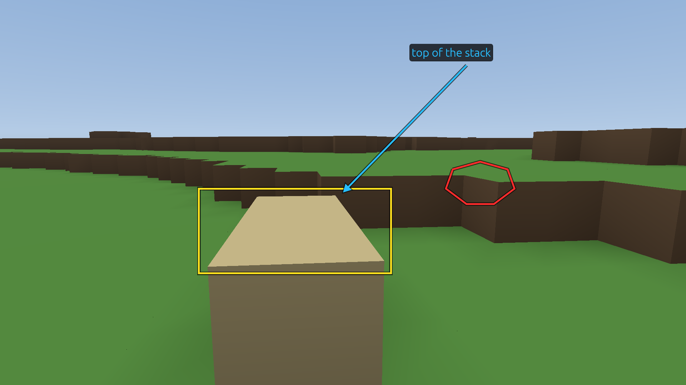
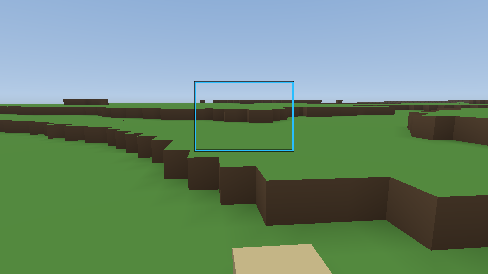

# Bug report: Sand stack sits too high (example)

Made 2026-10-31 09:36:27 UTC with Triangulum build d132cd89a. 2 marked item(s).

An example made by scripts/b6-report.play. The words are the script's and this is not a real bug.

## How to read this

Each numbered item below is one thing somebody saw and marked: what they wrote, the picture with their marks on it, the exact moment and the exact place. Pictures are in this folder and open with anything.

If you are here to fix something: the game is at https://github.com/dualmindblade/triangulum, and commands run from its `game/` folder. They assume this folder is at `game/interchange/reports/20261031-093627-sand-stack-sits-too-high-example/`; if it is somewhere else, change the path. Add `--bake DIR` if your checkout has no `game/assets/world/`.

## The recording

- **File:** `b6-sand.replay`, 3.2 seconds of play (193 steps at 60 a second), recorded 2026-10-31 09:36:21 UTC.
- **Build:** d132cd89a.
- **Watch it happen:** `cargo run --release -- --replay interchange/reports/20261031-093627-sand-stack-sits-too-high-example/b6-sand.replay --watch` plays it in a window at real time, and each marker's text shows as it passes.
- **Check it:** `cargo run --release -- --replay interchange/reports/20261031-093627-sand-stack-sits-too-high-example/b6-sand.replay` plays it with no window, takes a settled shot at every marker, and writes `out/replay/b6-sand/report.json`, which says separately whether the simulation reproduced and whether the look was the same.
- **If it will not play:** a recording only plays under the simulation rules and terrain generator it was made with, and a later build may refuse it. Nothing below depends on it: the pictures, the words and the poses stand on their own, and `--repro` rebuilds each frame. To play it anyway, check out the build above.

## What was marked

### 1. The sand stack came down, and its top now sits above the line of th...



- **What was written:** The sand stack came down, and its top now sits above the line of the terrace
- **When:** step 42, which is 0.70 seconds into the recording (taken 2026-10-31 09:36:22 UTC).
- **Picture with the marks:** `b6-sand.markers/marker01_step000042_annotated.png`. The clean frame is `b6-sand.markers/marker01_step000042.png`.
- **What the marks point at,** in pixels of the 1920 x 1080 picture, from its top left corner:
  - red pen line within (1248, 454) to (1440, 572)
  - yellow box from (557, 529) to (1094, 767)
  - blue arrow from (1306, 184) pointing at (960, 540)
  - blue text "top of the stack" at (1152, 130)
- **Where:** lat -4.56321, lon 117.47419, 45.6 m above sea level (2.1 m above the ground), facing 97.0 degrees and -8.6 up, walking; about 9.5 o'clock local time.
- **Exact teleport,** two lines for a `.play` script:

  ```
  pose -41671.80593246847,80138.9104734113,-7209.088194113242,5.551115123125783e-17,-5.551115123125783e-17,6.938893903907228e-18,1.6923787409636868,-0.1492668487310418,walk,1,0,0,20.0,3
  clock 990.9304144885082
  ```

- **The same frame again:** `cargo run --release -- --repro interchange/reports/20261031-093627-sand-stack-sits-too-high-example/b6-sand.markers/marker01_step000042.png` writes a script beside the picture and prints the command that runs it. It needs no recording.
- **Stand there by hand:** `cargo run --release -- --at -4.563212 117.474191 45.62 --look 96.966 -8.552 --time 9.5000 --walk`
- **The world had changed:** 1 chunk(s) were edited at this moment. A repro starts from an empty save, so it shows the land without those edits and its edit check fails at the end; the frame is still written. To see the edits, play the recording or use a copy of the save.
- **The frame is live:** it is what was on screen, so distant land may not have finished loading. A repro's frame is settled, so the distance can differ.
- **Made on:** build d132cd89a, terrain generator 4, simulation rules 3, world seed 42.

### 2. Second look from further along



- **What was written:** Second look from further along
- **When:** step 133, which is 2.22 seconds into the recording (taken 2026-10-31 09:36:23 UTC).
- **Picture with the marks:** `b6-sand.markers/marker02_step000133_annotated.png`. The clean frame is `b6-sand.markers/marker02_step000133.png`.
- **What the marks point at,** in pixels of the 1920 x 1080 picture, from its top left corner:
  - blue box from (768, 324) to (1152, 594)
- **Where:** lat -4.56278, lon 117.47512, 46.6 m above sea level (2.9 m above the ground), facing 97.0 degrees and -8.6 up, walking; about 9.5 o'clock local time.
- **Exact teleport,** two lines for a `.play` script:

  ```
  pose -41673.58975586993,80139.16810740788,-7208.482050887318,-0.6193514407483758,0.060642683430701005,4.254729868956341,1.6923787409636868,-0.1492668487310418,walk,1,0,0,20.0,3
  clock 990.9304144885082
  ```

- **The same frame again:** `cargo run --release -- --repro interchange/reports/20261031-093627-sand-stack-sits-too-high-example/b6-sand.markers/marker02_step000133.png` writes a script beside the picture and prints the command that runs it. It needs no recording.
- **Stand there by hand:** `cargo run --release -- --at -4.562777 117.475120 46.62 --look 96.966 -8.552 --time 9.5000 --walk`
- **The world had changed:** 1 chunk(s) were edited at this moment. A repro starts from an empty save, so it shows the land without those edits and its edit check fails at the end; the frame is still written. To see the edits, play the recording or use a copy of the save.
- **The frame is live:** it is what was on screen, so distant land may not have finished loading. A repro's frame is settled, so the distance can differ.
- **Made on:** build d132cd89a, terrain generator 4, simulation rules 3, world seed 42.

